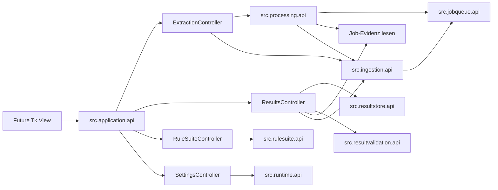

# AREV2 Architecture

## Ziel

AnalyzerResultExtractorV2 bleibt eine eigenstaendige Windows-Anwendung fuer PDF-basierte Analyse-Extraktion. Gleichzeitig stellt das Repo klar abgegrenzte Python-APIs bereit, damit spaetere Konsumenten dieselbe Pipeline ohne Direktimporte in interne Module nutzen koennen.

## Laufzeitbild

- Orchestrator: `src/jobcontroller/api.py`
- Headless Queue: `src/watchdog/api.py` + `src/jobqueue/api.py`
- Processing (Queue/Worker-Orchestrierung): `src/processing/api.py`
- Import-Instanz / Watch-Archiv / Recovery: `src/ingestion/api.py`
- Desktop Use Cases (neue Views): `src/application/api.py`
- Rule Authoring: `src/rulesuite/api.py`
- Assay-Kandidaten (read-only): `src/assaycandidate/api.py`
- Ergebnisvalidation (append-only): `src/resultvalidation/api.py`
- Runtime/Pfade: `src/runtime/api.py`

## SQLite-Ausgabe, Validierung und historische Evidenz (Paket 3a)

Owner bleibt `src/jobcontroller`; es gibt keinen neuen Persistenzowner, CLI-Pfad oder Planstand.

- Jede neue Verarbeitung verwendet ausschliesslich SQLite. `both` und `excel` sind akzeptierte Kompatibilitaetseingaben und werden vor Verarbeitung zu `sqlite`. Direkte unbekannte `submit`-Modi liefern `FAILED`; Runtime-/Worker-Konfigurationen fallen auch bei unbekannten Werten sicher auf SQLite zurueck. Desktop-Settings weisen unbekannte Werte weiterhin ab.
- Alle Assays werden vor dem ersten Sink extrahiert. Ein atomarer `output_plan` Version 2 mit `output_mode=sqlite` und `sqlite_status=pending` wird vor dem ersten SQLite-Side-Effect gespeichert. Derselbe vollstaendig identifizierte Versuch (`job_id`, PDF-Hash, Block-Hash und Payload) liefert beim Wiederanlauf den vorhandenen `run_id` als `already_persisted`. Ein anderer Job mit gleicher fachlicher Identitaet erzeugt weiterhin `duplicate_pending` mit Ledger-Referenzen. Auch dieser Fall hat ausschliesslich einen SQLite-Sink.
- `excel_status=not_required` und `export_retry_available=false` bleiben Kompatibilitaetsmetadaten. Neue Plaene haben kein Excel-Ausgabeziel. Erfolgreiche SQLite-Verarbeitung setzt Job und Queue auf `DONE`; Watch-PDFs duerfen dann unabhaengig von spaeterer menschlicher Validierung archiviert werden. SQLite-Fehler bleiben `FAILED` und archivieren nicht.
- `src.resultvalidation` bleibt alleiniger append-only Owner menschlicher Erstvalidation und Korrektur. `ResultsController` gibt den gespeicherten Datensatz zurueck (`excel_export_status=not_required`, leerer Exportfehler) und ruft keine Excel-Freigabe auf. Extrahierte Runs und eingefrorene Plaene werden dabei nicht geaendert.
- Vorhandene Arbeitsmappen und historische Ausgabeplaene bleiben unveraendert. V2-, unversionierte und unbekannte historische Plaene sind Diagnose-Evidenz; `retry_kind=retired` bietet keine ausfuehrbare Excel-Wiederholung. Die alten oeffentlichen `release_validated_run`-/`retry_excel_export`-Aufrufe liefern `SKIPPED` mit `reason=excel_export_retired`, ohne Plan-, Workbook- oder Lock-Schreibzugriff. Bereits `DONE` bleibt bei `submit` `SKIPPED: already_done`; andere historische Exportplaene liefern `FAILED: historical_output_plan_read_only`, ohne Export, Re-Extraktion, Migration oder Abschluss. Das wird nicht als `PENDING` wiederholt; der gemeinsame Processing-Retry weist diese Plaene ab.
- `excel_rules`, historische Schemata/Leser, `openpyxl` und der Writer-Modulvertrag bleiben fuer Kompatibilitaet erhalten. Neue Produktablaeufe rufen den Excel-Writer nicht auf. Das Original-PDF bleibt Pruefquelle; ein spaeterer PDF-Nachweis ist nicht Teil von Paket 3a.

## Echte Neuanalyse und Ergebnisrevisionen (Paket 3b)

`src.dbwriter.api` besitzt zusaetzlich die append-only Tabellen
`run_source_provenance`, `run_result_revisions`, `run_result_selections` und
`run_identity_aliases`. Die komponenteneigene Migration ist additiv,
transaktional und idempotent; Original-Runs, alte Jobdateien und eingefrorene
Ausgabeplaene bleiben unveraendert. Originalwerte sind Revision 0. Nur eine
ausdrueckliche ganze Auswahl macht eine neue Revision wirksam; sie validiert
keine Messung. Ein weiterer Analyseversuch ersetzt einen offenen Kandidaten
durch eine neue Revision mit Vorgaengerreferenz, ohne die alte Evidenz zu aendern.

`src.resultstore` projiziert ausschliesslich lesend den gewaehlten Stand samt
Kandidaten, Auswahlhistorie und Auswahlkennung. Filter, Chargen und Berichte
verwenden diese Projektion. Auch einzelne Arbeitslistenzeilen erhalten die
kanonische Report-ID aus derselben Gruppierung; Legacy-Cluster werden nicht
nochmals im Controller berechnet. `limit=None` liefert die vollstaendige
Population. Unbekannte/defekte Revisionsstaende sind sichtbare Klaerfaelle und
duerfen keine stillschweigende Originalfreigabe bewirken.

`src.jobcontroller.api.reanalyze_run` friert den aktiven Regelstand mit den
exakten, einmal gelesenen UTF-8-Bytes/SHA-256 ein und verwendet das urspruengliche
Geraet. Ingestion loest die aktuelle Original-/Archiv-PDF auf. Vollstaendiger
PDF-Hash, Normalisierungs-/Block-Hash und genaue Blockposition belegen die Quelle.
Gewoehnliche P3a-Runs lassen sich aus ihrem unveraenderten Ausgabeplan,
eingefrorenen Assay-Deskriptoren und Block-Hash rekonstruieren. Fehlende oder
mehrdeutige Nachweise fuehren zu Nacharbeit; eine aktuelle Assay-Bezeichnung
ersetzt keine historische Quellenzuordnung. Neue Erstverarbeitung parst eine
verifizierte temporaere PDF-Kopie und prueft den Live-Quellhash vor dem ersten
Sink erneut; sie speichert die genaue Quellen-/Regelprovenienz.

Reanalyse-PDF-Arbeit laeuft ueber die bestehenden Parser-/Normalizer-/Splitter-/
Extractor-APIs im Hauptthread eines frischen `spawn`-Prozesses. Eine gemeinsame
Sperre begrenzt auf einen solchen Prozess, 20 s inklusive Wartezeit, danach
terminate/kill mit hoechstens einer Sekunde Bereinigung. Grenzen: 128 MB PDF,
1000 Seiten und 8 MB serialisiertes Vergleichsergebnis. Es gelangen keine
MuPDF-Objekte oder Datenbankverbindungen in Application/Tk. Die P2-Vorschau bleibt
prozessisoliert und behaelt ihre eigenen Generation-/Seiten-/Zoom-Sicherungen.

Kandidat, Auswahl und Validation pruefen unter `BEGIN IMMEDIATE` erneut den
wirksamen Stand und dessen Verarbeitung/Validation. Der gemeinsame lesende
JobController-Abschlussguard prueft Job und vorhandene Queue; sein
`list_jobs(create_missing=False)` legt keine Verzeichnisse an. Bei Legacy-Runs
ohne historische Verarbeitungsevidenz bleibt der bisherige Direktaufruf fuer
eine unberuehrte Originalauswahl kompatibel. Neue Provenienz und Desktop-Aktionen
tragen den expliziten Projektkontext. Teure Analyse erfolgt ausserhalb der
Transaktion; beim Publizieren wird die Berechtigung wieder geprueft.

`src.resultvalidation.api.list_run_validations_readonly` erzeugt weder Schema
noch Schreibsperre und ist unter einer aeusseren Writer-Transaktion verwendbar.
Die alten Leser behalten ihren schemaerzeugenden Kompatibilitaetsvertrag.
Validationen binden `revision_id`, `selection_id` und `selection_token`; alte
Eintraege bedeuten Originalrevision 0. Nach einer Analyse/Auswahl ist eine
explizite, zur angezeigten Messung passende Kennung erforderlich. Offene
Kandidaten, veraltete Kennungen und jedes leere konfigurierte Feld sperren die
Validation. Sowohl alte als auch neue Auswahl erfuellen alle Feldschluessel des
eingefrorenen aktuellen Regelwerks, unabhaengig von `required`. Ein vollstaendiger
Altstand darf einen fehlgeschlagenen, quellenbelegten Kandidaten ausdruecklich
ablehnen; ein ungepruefter Rueckfall erfolgt nie.

Die vorhandenen `ResultsController`-/`ValidationView`-Owner organisieren
Mehrfachauswahl und sequenzielle Hintergrundanalyse. PDF, Vergleich und Auswahl
folgen der fokussierten markierten Zeile. Der Vergleich enthaelt alle alten/neuen
Felder und Metadaten; `Alte Werte behalten` und `Neue Werte uebernehmen` fuehren
zur getrennten Erstvalidation zurueck. Jede Aktion erhaelt die beim Anzeigen
erfasste Datenbank und Kennung. Vier Controller bleiben bestehen; die ausdrücklich freigegebene Statistik-Navigation ergänzt die siebte View.

## Regelfreigabe im vorhandenen Editor (R1)

Der geladene Entwurf wird im bestehenden dreispaltigen Workspace direkt über
„Mit PDFs prüfen“ freigegeben vorbereitet. Struktur, Beispiel-/Problem-PDF,
Update-Referenz und Gesamtstatus sind getrennt sichtbar; ein erfolgreicher
Nachweis aktiviert nichts. Genau eine abschließende Bestätigung in ReleaseMixin
führt über denselben RuleSuiteController zur Aktivierung. Der vorhandene Wizard
bleibt Erstellung-/Feldhilfe und gibt höchstens einen geprüften Entwurf zurück.
Ungespeicherte Felder, Meta-/PDF-/Root-/Draftwechsel und verspätete Workerresultate
können keinen alten Nachweis aktivieren. Ein alter Callback darf weder den Status
noch Busy eines neueren Prüfversuchs zurücksetzen. Zerstörte Fenster verwerfen
Completion-Ereignisse. Die neue PDF-Proofarbeit nutzt den bestehenden TkTaskRunner
mit threadsicherer Queue und ausschließlich auf dem Hauptthread geplantem Tk-Polling;
ein Proof-Worker ruft kein Tk-`after` auf. Reine Diff-/Strukturansichten serialisieren
saubere bytegebundene Entwürfe nicht neu.

Der bestehende readiness-Owner erzeugt Proof-Version 2 aus exakt erfassten
Draft-/Index-/Active-/PDF-Bytes. Kurze Lifecycle→Draft-Sperren schützen Capture,
Pending und Ready-Publikation; PDF-Arbeit läuft ohne langfristig gehaltene
TTL-Sperre. Private Snapshots speisen die echte Extraktion. Der private Index
verweist für den geprüften Assay stets auf die private Active-Kopie, auch wenn
die originale Bindung absolut oder ein Alias ist. Originalpfade und Original-
Hashes bleiben im Nachweis. Vor Ready werden aktueller Modus, Bindungen und
Inputs erneut geprüft. Eine Versuchskennung verhindert, dass ältere langsame
Ergebnisse neuere fehlgeschlagene Prüfungen überschreiben. Keine zweite
Nachweisablage oder Workflowengine entsteht.

Beim Update müssen alle bisherigen Referenzfelder und `lot_id` gleich bleiben;
gleiche PDF-Bytes sind auch unter anderem Dateinamen keine Referenz. Der echte
Extractor verlangt weiterhin jedes konfigurierte Feld, auch `required=false`.
Der proofpflichtige Produktpfad prüft innerhalb derselben bestehenden
Aktivierungsowner und konsistenter Lifecycle→Draft-Sperrfolge nochmals, bindet
die tatsächlich publizierten Draftbytes und verwirft ungetestete Namensargumente.
Untere API-Aufrufe bleiben mit optionaler Proofpflicht kompatibel. Die zentrale
Draftnamenbildung verwirft pfadartige Assaykeys hostunabhängig und behält die
zusätzliche resolved-Enthaltenheitsprüfung gegen Symlinks. Vorhandene Regeln
werden nicht dafür umgeschrieben.

## Modulgrenzen

### Versionierte Geräte- und QC-Autorität (P4/P5)

`src.qualitycontrol.api` ist der einzige Geräte-/QC-Owner im selben effektiven
SQLite-Speicher wie Results. Genau fünf eigene Tabellen halten Schema-/
Migrationsnachweis, vollständige Inventarversionen, vollständige Profilversionen,
Chargenrevisionen und unveränderliche Analyse-/PDF-Nachweise. Schreibaktionen
verwenden `BEGIN IMMEDIATE`, eindeutige Vorgänger und Anfragekennungen. Lesen
verwendet ausschließlich `mode=ro` und erzeugt weder Datenbank noch Schema;
Änderungen bestehender Speicher öffnen mit `mode=rw` ohne Neuanlage bei Dateirennen.

`config/devices.json` wird nur bei ausdrücklich gewählter Übernahme gelesen,
hashgeprüft und gemeinsam mit der vollständigen historischen Gerätepopulation
transaktional übernommen. Originalbytes und historische Ergebniszeilen bleiben
unverändert. Fehlende Altgerätedaten werden sichtbar unvollständig geführt;
Namen/SN/LNR/EVA werden nicht erfunden. Neue Geräte brauchen einen Namen und
mindestens SN, LNR oder EVA. Runtime-Gerätefunktionen behalten ihre bisherigen
Positionsargumente und verlangen zusätzlich den ausdrücklich erfassten
`store_spec`. Lazy Imports verhindern den ResultValidation/JobController/Runtime-
Importzyklus. QC importiert weder Runtime noch Application. Vor Einrichtung bleibt
`DEFAULT_DEVICE` als sichtbare unvollständige Import-Kompatibilitätskennung;
explizite historische IDs werden ohne Registrierung aufgelöst. QC verlangt eine
verwendbare Inventaridentität. Historische DONE-Jobs bleiben auch bei unlesbarem
QC-Speicher übersprungen; neue Auflösungsfehler liefern kontrolliert FAILED.

Profile speichern stabile Kontrollkennungen und vollständige IST/SOLL/MIN/MAX-
Zuordnungen, explizites Messdatumsfeld/-format, Dezimalpunkt oder Dezimalkomma
ohne Tausendertrennung, Einheit, Anwendbarkeit/relative Grenze, optionale SD,
Analysenlauf-Feld und `classic-six-v1` samt Regelauswahl. Profile und Chargen
werden versioniert, niemals überschrieben. Messwerte bleiben roh erhalten;
ungültige Zahlen/Daten und Ziel-/Einheitenkonflikte werden ausgeschlossen und
benannt. Extrahierte Uhrzeiten bleiben erhalten. Gleichzeitige Messungen erhalten
keine erfundene Messreihenfolge; deterministische Listenreihenfolge ist kein
wissenschaftlicher Reihenfolgenbeleg.

Optional kann eine neue Profilfassung `measurement_time_field` und
`measurement_time_format` gemeinsam angeben. Fehlen beide oder sind beide leer,
bleibt die alte normalisierte Profilform exakt ohne zusätzliche Schlüssel.
Teilbelegung und ein bereits zeitbehaftetes Datumsformat sind im getrennten
Modus unzulässig. Das Zeitformat verlangt %H/%M, optional %S, ohne Datum,
Locale- oder Zeitzonendirektiven. Nur der neue Quellenzweig parst die explizite
Uhrzeit streng mit Roundtrip und kombiniert sie mit dem extrahierten Datum.
Fehlend/leer ergibt `measurement_time_missing`, ungültig
`measurement_time_invalid`, jeweils `measured_at=None` und Ausschluss ohne
Fallback. Nur dieser Zweig ergänzt `measurement_time_raw` im Quellenbezug und
setzt `order_is_explicit=True`. Der bisherige Datums-/kombinierte Zeitstempelweg,
gleiche-Zeit-Barrieren und vollständige Manifest-/Head-/Stale-Guards bleiben.
Das bestehende Profildialog-Formular lädt/speichert die optionalen Felder mit
derselben assaybezogenen Feldauswahl; es gibt keine automatische ZEIT/time-Wahl,
keine Migration, keine Schema-, Statistik- oder SD-Definitionsänderung.

Quellen kommen aus `list_result_runs(limit=None)` und
`list_run_validations_readonly`. Nur vollständige, lesbare, ausgewählte Ergebnisse
mit einer eindeutigen passenden wirksamen menschlichen Validierung werden
eingeschlossen. Leere alte Bindungskennungen gelten nur für unberührte
Originalrevision 0. Das Manifest enthält die vollständige beobachtete Population
einschließlich Ausschlüssen, Roh-/Dezimalwerten, Datumswerten, Ergebnis-/Auswahl-/
Validierungskennungen, Quellhashes und vollständiger Konfiguration. Getrennte
Owner-Lesevorgänge sind kein atomarer Latest-Snapshot: genau dieses Manifest
definiert die Population und wird vor Publikation unter dem QC-Schreiblock erneut
geprüft.

Chargenidentität ist Gerät/Assay/exakte extrahierte Kit-Charge. Der statistische
Beginn bleibt das älteste geeignete Messdatum. Die davon unabhängige Nutzung
kommt aus `get_lot_chronology`: alle projizierten Ergebnisse, auch unvalidierte
und numerisch ungeeignete, mit Datum-/Zeitpräzision und möglichen offenen
Kandidatenidentitäten. `QCUsageSnapshot` hält das vollständige kanonische JSON
und seinen Hash. Tage ohne gemessene Uhrzeit sind ganze Tagesintervalle;
nur zusammenhängend explizite Stunden/Minuten/Sekunden verfeinern sie. Fehlende
höhere Zeitkomponenten werden nicht durch strptime-Standardwerte ergänzt.

Abschluss setzt mindestens einen geeigneten Zielchargenwert und eine sicher
spätere Nutzung einer anderen Charge voraus; ein späterer Beginn oder eine
Validierung dieser belegenden Messung ist nicht erforderlich. Gleichstände,
überlappende Zeitintervalle und unbekannte Zielnutzung werden nicht künstlich
geordnet. Unlesbare Revisionshistorie mit unbekannter Kandidatenidentität
verlangt gruppenweite Klärung. Der Nachweis ist paarweise und behauptet keine
global neueste Charge. Bestehende Bindung oder ausdrückliche Profilwahl liefert
den Kontext; widersprüchliche zeitliche Interpretationen bleiben sichtbar.

ResultsController bereitet über `prepare_qc_lot_close` Modell und echte PDF
rein lesend vor. Der bestehende Statistikknopf „Abschluss prüfen“ öffnet diesen
Vorschlag mit allen Leveln, Quellen und Klärungsgründen. Abbruch speichert nichts.
`close_qc_lot(preview, ...)` veröffentlicht die vorbereiteten Bytes; unter
`BEGIN IMMEDIATE` prüft der einzige QC-Schreibowner Ziel-/Zeugenquellen,
Profil/Inventar, vollständigen Chronologietoken, erwarteten Chargenkopf,
Modell-/PDF-Hashes und SD-Bindung erneut. Abschluss und Nachweis entstehen
atomar. Erwartete Abwesenheit (`expected_version_id=0`) erlaubt den direkten
ersten abgeschlossenen Snapshot ohne beiläufige offene Revision oder neue SD.
Die finale Veröffentlichung sperrt Dialogabbruch und Fensterschließen.

Neue Werte ändern weder geschlossenen Zustand noch Archivbytes; ein separater
Live-Änderungshinweis bleibt neben der Archivansicht sichtbar. Eine begründete
Wiederöffnung erzeugt ausdrücklich eine neue Revision; frühere PDFs bleiben
bytegenau lesbar. Manuelle SD und ausdrücklich bestätigte validierte
Referenzserien werden eingefroren. P5 bewahrt diese rohen Referenzen unverändert
und ergänzt berechneten Mittelpunkt und Stichproben-SD im Analysemodell. Ohne
verwendbare SD bleibt SD-Auswertung unverfügbar.

SettingsController/SettingsView verwalten Geräte und Profile; ResultsController
und die eigene StatisticsView organisieren die Chargen-/QMMA-Arbeit. Dialoge zeigen benannte Fachfelder, Kontrollen und Regel-Feldauswahl;
Speichern bleibt bei kleinen Fenstern erreichbar. Datenbankzugriffe und
Quelllisten laufen über `TkTaskRunner`. Mutationen sind an angezeigten Speicher
und Version gebunden; verspätete Antworten werden verworfen. Es gibt weiterhin
vier Controller, vier Servicefelder und sieben Views. Statistik organisiert
**Mit PDF abschließen**, explizite Nachfolgechargenwahl, historische
Nachweisfassungen und Export an einen neuen Dateinamen.

### Unveränderliche Analyse und PDF (P5)

`qualitycontrol/analysis.py` berechnet mit Decimal. QMMA ist
`sqrt(sum((IST-SOLL)^2)/n)`; der relative Wert verlangt einen positiven,
konsistenten SOLL-Wert. Ziel-/Einheitenkonflikte und leere Populationen sind
unverfügbar. Grenzentscheidungen verwenden ungerundete Quadratevergleiche;
Gleichheit überschreitet die Grenze nicht. QMMA ist unabhängig von SD. Manuelle
SD verlangt einen positiven endlichen Wert; bestätigte Referenzserien verwenden
ausschließlich eingefrorene Messwerte, deren Mittelwert und Stichproben-SD
(`n-1`, mindestens zwei Werte). MIN/MAX erzeugen keine SD; SD null ist unverfügbar.

`arev2-qc-analysis-v2` verlangt belegte SD-Herkunft. Der lesende QC-API-Resolver
`get_sd_reference_context` bindet Referenzhash, Herkunftsprofil/-hash und
gegebenenfalls die vollständig belegte Chargenhistorie an das zusätzliche
Modellfeld `sd_reference_context`. Neue manuelle Referenzen frieren ihre
Profilfassung vor Bildung der Referenzkennung ein. Bereits eingefrorene
Referenzen werden exakt übernommen; es gibt keine Migration oder Änderung
alter Referenzen/Profile. Ältere manuelle Referenzen ohne direkten Profilbezug
brauchen eine vollständige, zusammenhängende Historie ihres Entstehens.

Der Vergleich umfasst stabile Profil-/Geräte-/Assay-/Kontrollidentität, IST-Feld,
Zahlengrammatik und effektive Einheit/Einheitenfeld. Namen, Datumsformat,
Gruppierung, Regeln, relative Grenze, SOLL und MIN/MAX definieren keine SD und
sperren sie nicht pauschal. Fehlende Herkunft oder eine andere Messwertdefinition
liefert SD-unavailable mit Grund, ohne QMMA zu deaktivieren. Origin-Kontext wird
beim Lesen gegen den aktuellen Chargenstand erneut geprüft; bestehende
Speicher-/Quell-/Abschlussguards bleiben. `analyze_lot` bleibt reine Mathematik.
Gespeicherte unterstützte v1-Modelle werden weiterhin ohne ergänzte Standardfelder
oder Neuberechnung gelesen und mit ihren originalen PDF-Bytes exportiert.

`classic-six-v1` verwendet strikt `>1`, `>2`, `>3` SD. Das aktuelle
2-SD-Prüfsignal gilt unabhängig von der Regelauswahl; `1_2s` schaltet nur die
Warnanzeige. R4s verlangt in demselben belegten Analysenlauf einen Wert über
+2 SD und einen unter -2 SD. Längsfolgen bleiben je Kontrolle/Parameterfassung;
gleichdatierte oder identische Zeitstempel ohne belegte Ordnung und bekannte
unbrauchbare Beobachtungen unterbrechen betroffene Historienfenster. Importzeit,
Kennungen und Listensortierung ersetzen keine Messreihenfolge. Es gibt keine
günstige Teilmengenauswahl oder kontrollübergreifende Längspoolung. Fehlende
SD/Ordnung/Gruppierung werden mit Gründen sichtbar; menschliche Validation
bleibt unabhängig.

P2 erzeugt Modellversion 2 mit `arev2-qc-analysis-v3` und `arev2-qc-pdf-v3`.
Die vier bisherigen Modellversion-1-Kombinationen aus Analyse v1/v2 und PDF v1/v2
bleiben lesbar; ungültige Querkombinationen werden abgewiesen. Neue
Quellenmanifeste heißen `qc-sources-v2`. Hersteller-MIN/MAX brauchen dieselbe
Decimal-Konstanz wie SOLL und Einheit. Getrennte Hersteller-/Prozentgrenzen,
Punktbefunde und `chart.reference_lines` sind eingefroren; UI/PDF berechnen keine
Grenzwerte. Die profilweite Einzelwertabweichung p erzeugt pro Level
`SOLL × (1 ± p/100)`, unabhängig von QMMA/SD/Westgard. Gleichheit liegt innerhalb;
Grenzüberschreitung schließt den Punkt nicht aus. Tatsächlich vertauschte
Prozentgrenzen bleiben erklärt unverfügbar, auch bei negativem SOLL. SOLL null
und p null werden ohne Sonderumdeutung berechnet. Altmodelle erhalten beim Lesen
oder erläuterten Drucken keine rückwirkenden neuen Linien.

P4 vom 13.11.2026 erzeugt zusätzlich genau Modellversion 3 /
`arev2-qc-analysis-v4` / `arev2-qc-pdf-v4`. Das historische Tupel
2 / analysis-v3 / pdf-v3 bleibt literal erhalten. Der reine Analyseowner friert
je Level `descriptive` (n, Mittelwert, empirische Stichproben-SD mit n-1, VK),
`period`, stabile Darstellungspositionen und je Punkt `measurement` sowie absolute
und relative absolute Abweichungen ein. Grundgesamtheit bleiben die bereits
geeigneten Werte. Die exakt budgetierte Decimal-Varianz verwendet
`(n*sum(x²)-sum(x)²)/(n*(n-1))`; n<2 gibt keine empirische SD, nichtpositiver
Mittelwert keinen VK. Relative Einzelabweichungen brauchen positiven SOLL.
Ausgeschlossene Werte erhalten keine scheinbar gültigen Abweichungen. Diese
empirische SD ist ausdrücklich keine freigegebene Westgard-Referenz. Eine
vorhandene Mittelwertlinie gehört ebenfalls zu `chart.reference_lines`.
Datums-/Zeitpräzision folgt nur zusammenhängend belegten H/M/S-Komponenten;
fehlende Zeiten werden nicht ergänzt. UI und PDF verwenden die eingefrorenen
Zahlen, die Anzeige rundet auf sechs signifikante Stellen. Historische Modelle
erhalten weder Deskriptivwerte noch Abweichungen nachträglich.

`QCAnalysis` hält nur kanonisches JSON und SHA-256 unveränderlich. Sein Modell
enthält das vollständige Manifest, unveränderte rohe SD-Referenzen, berechnete
Serien, Diagramm, Befunde, Nichtverfügbarkeitsgründe, Zählungen und
Verfahrens-/Referenzfassungen. UI und PDF verwenden dasselbe Diagrammmodell.
Historische/geschlossene Nachweise werden aus gespeicherten Modellen geladen,
niemals mit heutigen Quellen neu berechnet. Eine offene Analyse wird vor
Abschluss gegen neu erfasste Quellen und Konfiguration geprüft.

`qualitycontrol/pdf_report.py` rendert außerhalb des Datenbank-Schreiblocks in
einem frischen `spawn`-Prozess; nur dessen Hauptthread importiert/verwendet
MuPDF. Ein globaler Slot begrenzt auf einen QC-Renderer. Budget einschließlich
Slotwartezeit: 25 s, danach terminate/kill mit höchstens 1 s Zusatzbereinigung.
Grenzen: 16 MiB Modell, 50.000 beobachtete Punkte in der Analyse, 200 PDF-Seiten,
64 MiB PDF, 4 KiB Prozessmetadaten. Dateibasierter Austausch vermeidet einen
vollen Pipe-/Queue-Puffer. Der Kindprozess prüft die echte PDF erneut; Eltern
prüfen Größe/Hash/Identitäten. Lange Tabellen werden paginiert, unbeherrschbarer
Inhalt liefert einen kontrollierten Fehler. Anschließend prüft `close_lot`
Quellen/Konfiguration erneut und speichert PDF und Abschluss atomar. Rendering-
oder Konfliktfehler lassen die Charge offen. Export prüft gespeicherte Hashes
und erstellt standardmäßig ausschließlich eine neue Datei mit den archivierten Bytes.

Die aktuelle Darstellung `arev2-qc-pdf-v4` verwendet kompakte A4-Abschnitte je
Level: dreiteiliger Kopf aus belegten Stammdaten, Diagramm mit rechter Legende,
zwei Statistikspalten, Messwerttabelle und leere Unterschriftsfelder. Elf übliche
Messungen passen auf eine vollständige Seite; die geprüften Standardbeispiele
mit 60 Messwertzeilen insgesamt benötigen höchstens drei Seiten. Ein Folgelevel
kann mit vollständigem eigenem Kopf, Diagramm und Statistik auf derselben Seite
beginnen. Eingebaute Times-Roman/Times-Bold vermeiden externe Fontabhängigkeiten;
Datum/Zeit bleibt einzeilig, Zeilen sind gleichmäßig kompakt. Die Zeitachse bleibt
echt, zu dichte Beschriftungen werden ausgelassen. Farbe und Strichart trennen
Grenzlinien; Ringe und Punktsymbole kennzeichnen Grenz- beziehungsweise Westgard-
Befunde. Fortsetzungen wiederholen Gerät, Assay, Kit-/Reagenzcharge, Level und
Tabellenkopf. Reine Datumswerte erzeugen keine scheinbar erfassten Uhrzeiten.

Darstellungsnummern (Pos) sind je Level stabil an `point_key` gebunden, keine
analytischen Läufe. Laufangaben stammen nur aus einem ausdrücklich konfigurierten
`run_grouping_field` und dessen eingefrorenem `run_group_raw`; technische Run-IDs
sind ausschließlich Nachweisidentitäten. Anwender stammt aus dem eingefrorenen
Quellenpayload (`ANWENDER` oder Legacy-Alias `user`), Validierer und UTC-Zeit
nur aus dem zu Ergebnis/Revision/Auswahl passenden Nachweis. Fehlende Bindungen,
mehrdeutige Anwender und ausgeschlossene Punkte bleiben im Standard mit Position
und verständlichem Grund sichtbar. Vollständige lange Rohangaben, Identitäten
und Validatorbindung bleiben im bestehenden digitalen Analysemodell erhalten;
der Fuß nennt die Modellkennung. Der Renderer fügt keinen JSON-Rohdatenanhang
hinzu. Zusätzliche technische Papiernachweise sind bewusst optional. Weder Klinikdaten aus dem
Vorlagenbild noch Hersteller-/Kontrollmaterialnamen, Kalibrationen oder
Unterschriften werden erfunden.

`include_explanations=False` bleibt Standard und druckt die fachliche Auswertung
mit Legende und wichtigen positionsgebundenen Befunden. Technische Quellen-/
Validierungslisten und wiederholte Einzelprobenbelege werden nur mit
`include_explanations=True` zusätzlich gedruckt, ebenso Methoden, Referenzen und
die vollständige Westgard-Regelliste. Beim Export bedeutet der Standard weiterhin
unveränderte Archivbytes. Die optionale Druckfassung verwendet nur das gespeicherte
Modell, bei alten Modellen den bisherigen Layoutzweig und ausschließlich damalige
Kennzahlen; DB, Modell und alte PDF bleiben unverändert. Der Bool-Modus bleibt
beim Spawn und in den Rückgabemetadaten geprüft. Die echten prä-P2- und prä-P4-
Fixtures binden ursprüngliches Modell/PDF, Hash und Herkunft.

Assaynamen sind Präsentationsdaten im bestehenden Application-Owner. Der
ResultsController bevorzugt die tatsächlich ausgewählte Revision, sonst den
Original-Provenienzstand; anschließend gespeicherte öffentliche Job-Evidenz
(Writer vor Splitter), zuletzt den aktiven Katalog über RuleSuiteController.
Eine offene Kandidatenrevision benennt den aktuellen Stand nicht um. Namen werden
in additiven DTO-Feldern bzw. `ReportAssayGroup.assay_display_label` geführt;
technische Schlüssel bleiben Identitäten, Filter und versteckte Tabellenwerte.
Fehlende Namen heißen ausdrücklich "Assayname fehlt", Dateihinweise bleiben
"Namenshinweis". Gleichnamige Auswahleinträge sind über ihren Index gebunden.
Neue QC-Modelle frieren Namen separat in `presentation` ein, ohne das
Quellenmanifest, SD-Referenzen, Statistik oder Schema zu verändern.

### Produktversion und Buildnachweis

Version 2.0.0 stammt aus `pyproject.toml`. `runtime.api.get_build_info` liest im
Quellbetrieb relativ zum Code und im EXE-Betrieb `build-info.json` neben der EXE,
unabhängig von `ARE_HOME`. Die Shell lädt diese Angaben über SettingsController
im Hintergrund; zur Laufzeit laufen keine Git-Prozesse oder Hashscans.
Der kanonische Builder führt einmal die volle Testsuite vor jeder Bereinigung
aus. Erst bei Erfolg folgen die drei ausdrücklich begrenzten Buildziele;
`deploy_smoke` bleibt erhalten. Das Manifest hält tatsächlichen Ausgangscommit,
Dirty-Zustand, UTC-Zeit, Abhängigkeiten und deterministischen Fingerabdruck aller
rohen Produkt-Buildeingaben fest. Windows-CRLF-Bytes werden nicht mit Git-LF-
Blobs gleichgesetzt. Ein späterer Merge-/Tagbezug wird extern verifiziert und
nicht vorab erfunden. P5 führt keine weitere Tabelle oder Abhängigkeit ein.

- Oeffentliche Produktionsgrenzen liegen unter `src/<modul>/api.py`.
- Interne Implementierungen (`*.model`, `*.service`, `*.helpers`, `*.queue`, `*.jobcontroller`) bleiben hinter diesen APIs.
- Adapter und UIs importieren fremde `src`-Module nur ueber deren `api.py`.

## Entry Points

### Root-Wrapper

- `test_app_main.py` — Produkt-Shell `AnalyzerDesktopApp` (Feldversuch-Default); `LegacyTestApp` via `ARE_LEGACY_UI`
- `watchdog_main.py`
- `worker_main.py`
- `rule_editor_main.py`
- `main02.py`
- `rule_suite_main.py`
- `rules_validate_main.py`

Diese Dateien enthalten nur noch schlanke Delegation auf `interfaces/` bzw. Tk-Adapter.

### Interfaces

- `interfaces/headless/`
  - `watchdog.py`
  - `worker.py`
- `interfaces/cli/`
  - `e2e.py`
  - `rule_suite.py`
  - `rules_validate.py`
- `interfaces/tk/`
  - `test_app.py` — `AnalyzerDesktopApp` (Default) und `LegacyTestApp` (Fallback)
  - `watch_scan.py` — In-App-Watch-Scan
- `interfaces/common/`
  - `queue_worker.py` — duenner Kompatibilitaets-Re-Export auf `src.processing.api`

Hier liegt Adapter- und CLI-Orchestrierung, aber keine zusaetzliche Fachlogik.

## Application / Processing / Ingestion (Phase 1–2)

- `src/application` ist Tk-frei; importiert keine `interfaces/*`-Module und keine internen Fremd-`src`-Implementierungen. Exakt vier Controller-Module/-Klassen und exakt vier `DesktopAppServices`-Felder (`extraction`, `results`, `rules`, `settings`).
- `src/processing` besitzt die Queue-/Worker-Orchestrierung (ein wartender Job, DONE/FAILED/already_done/deferred/Exception-Semantik) und ruft nach terminalem Queue-Status `src.ingestion.api` zur Reconciliation auf.
- `src/ingestion` ist alleiniger Owner fuer Import-Instanz-Ledger (`ingestion_id`), Watch-Scan/Stabilitaet, Archivierung/Recovery und `current_path`. Persistenz: `<project_root>/storage/ingestion/*.json` (atomar, file-backed; corrupt/invalid JSON fail-closed). Archive publish: verified partial → exclusive `os.link` into final target (same volume, no overwrite); unsupported/failed link fails closed with source+partial preserved. Archive-Status inkl. `RECOVERY_REQUIRED` wenn Quelle+Ziel fehlen und kein verifiziertes Partial finalisierbar ist. Keine Writes in `src.resultstore`.
- `SettingsController` persistiert optional `<project_root>/storage/desktop_settings.json` fuer den effektiven `output_mode=sqlite`, `sqlite_path`, `watch_enabled`, `watch_input_path`, `watch_backup_path`, `watch_recursive`, `device_id` und `operator_initials` (Legacy-Alias `watch_dir` beim Laden). Initialen werden getrimmt; `watch_enabled` / `watch_recursive` Default `false`. Archiv-Eligibility nur bei Queue-Status `DONE` (nicht `FAILED`).
- Phase 3A: Application-Readmodels/DTOs fuer Ingestion-Instanzen (`IngestionInstanceItem` mit queue-aware `display_status`), Report-Lesen (`ReportSummaryItem`/`ReportDetail` via `src.resultstore.api.list_report_summaries`/`get_report_runs` mit gemeinsamer Owner-Gruppierung: primaer `job_id`, Legacy-Fallback normalisierter `pdf_path` + deterministisches `created_at`-Fenster `LEGACY_REPORT_TIME_WINDOW_S=5.0`), Nacharbeit-Diagnose (`JobDiagnosisItem` via gehaertetem `get_job_evidence` inkl. begrenztem `context_text`/`context_source_label`; Volltext-Discovery via `get_job_diagnostic_sources`), Duplikat-Diagnose (`DuplicateCandidate*`/`DuplicateExistingRunItem`/`DuplicateDecisionResult`), Assay-Kandidaten (`RuleSuiteController.discover_assay_candidates` und `discover_assay_candidates_for_job`), Watch-/Device-Readmodels (`WatchTimingSettings` mit safe Normalisierung `max(0.5, scan)` / stabile Fenster-Regeln, `DeviceInventoryStatus`), zentraler Statusmapping-Vertrag (`presentation.py`), kontrollierte Desktop-Aktionen (`SettingsController.open_output_folder`, `ResultsController.open_report_pdf`; generische `open_path` nicht oeffentlich).
- Phase 3B (Shell), aktueller Stand: `AnalyzerDesktopApp` in `interfaces/tk/test_app.py` — sieben Views (`dashboard`, `results`, `statistics`, `validation`, `rules`, `settings`, `diagnostics`), `TkTaskRunner` fuer Hintergrund-I/O, Orchestrierung ueber `src.application.api` (vier Controller). Default-Start: `test_app_main.py` → `run_entry` → `main()` → `AnalyzerDesktopApp`; Fallback `LegacyTestApp` via `ARE_LEGACY_UI`. Controller-/Storage-Zugriffe nicht auf dem Tk-Hauptthread; Widgets/Dialoge nur im UI-Thread. Gate 3 wurde historisch mit kompletter Suite, Onedir-Build und manuellem Tk-Smoke abgeschlossen; der aktuelle Statistik-Navigationsstand wird gesondert in TESTBASELINE qualifiziert.
- `ExtractionController.run_watch_cycle()` ist headless testbar; `interfaces/headless/watchdog.py` delegiert dorthin (kein Event-Watchdog). Stable-Window-Normalisierung entspricht `SettingsController.get_watch_timing()`.
- `ResultsController` loest `current_pdf_path` additiv ueber `src.ingestion.api.resolve_current_path` (Exact-Match; sonst Legacy-Fallback; Mehrdeutigkeit ohne Willkuer-Auswahl). Report-`display_status` priorisiert echte Queue-Status aus `src.jobqueue.api.list_jobs`, sonst Ledger-Status der exakt aufgeloesten `ingestion_id`; `DONE` nur bei leerem `job_id`, `legacy_fallback` und ohne Queue-/Ledger-Evidenz.
- Phase 4: `src.resultvalidation.api` ist alleiniger Owner der Tabelle `run_validations`. Erstvalidation und explizite Korrektur sind append-only; Korrekturen verweisen ueber `supersedes_validation_id` auf den vorherigen Stand. `src.resultstore` bleibt read-only. `ResultsController` reichert Report-DTOs mit aktueller Validation und Historie an und leitet `Unvalidiert`, `Teilweise validiert`, `Validiert` bzw. bei Fehler/Klaerfall `Pruefung erforderlich` ab. Die Tk-View schreibt nie direkt nach SQLite.
- Validierungs-PDF: Die bestehende `ValidationView` zeigt links das Original-PDF und rechts die bestehende Arbeitsliste samt Erstvalidation. Die Shell maximiert beim Eintritt normal mit Titelleiste und stellt beim Verlassen den vorherigen Fensterzustand wieder her. `ResultsController.render_report_pdf_page` loest jede Anfrage ueber die bestehende Report-/Ingestion-`current_path`-Logik auf; mehrdeutige oder fehlende Quellen werden nicht ersetzt. Der interne Owner `src/application/pdf_preview.py` rendert pro Seite in einem frischen `spawn`-Prozess. Nur dessen Hauptthread importiert/verwendet MuPDF; kein MuPDF-Objekt verlaesst den Prozess. Eine globale Render-Sperre begrenzt auf einen Vorschauprozess. Budget fuer Sperre plus Kindprozess: 8 s, danach terminate/kill (bis 1 s zusaetzliche Bereinigung). Begrenzungen: PDF 128 MB, 1000 Seiten, manueller UI-Zoom 25–300 % (automatische Breitenanpassung auch darunter, Renderer akzeptiert nur endliche positive Werte bis maximal 300 %), Bilddimension 3000 px, insgesamt 6 Mio. Pixel; effektiver Zoom darf fuer grosse Seiten kleiner sein. Der Elternprozess liest begrenzte Metadaten/PPM erst nach Kindprozess-Ende und prueft Dateistabilitaet. Tempdateien werden entfernt. `test_app_main.py` ruft `freeze_support` vor dem UI-Import auf. Tk-`PhotoImage` entsteht ausschliesslich im UI-Callback. Eine koaleszierte Vorschauanfrage plus Generation/Report/Run/Seite/Zoom verhindert veraltete Bilder nach schneller Auswahl, Navigation, Refresh oder Ansichtswechsel. Nach einem Seitenfehler bleiben bekannte Seitengrenzen fuer Zurueck/Weiter erhalten; unbekannte Dokumente haben keine Seitennavigation. Aktualisieren startet stets auf Seite eins und entdeckt die Seitenzahl neu, auch wenn derselbe Bericht nun auf eine kuerzere PDF verweist. Es gibt keinen weiteren Controller, keine generische Dateisystem-API und keine zweite Validierungspersistenz.
- `ProcessingOutcome` bleibt bewusst queue-/extraktionsbezogen (`processed`, `job_id`, `queue_status`, `submit_status`, …). Ein Queue-Job kann mehrere Ingestion-Instanzen bedienen; per-Instanz-`archive_status` / `archive_error` liegen in `ImportRecordItem` und sind ueber `ExtractionController.list_import_records` / `get_import_record` abrufbar — kein singulaeres `ProcessingOutcome`-Feld, um den spaeteren GUI-Statusvertrag ohne DTO-Churn zu erfuellen.

### GUI

- `test_app_main.py` startet die Produkt-Shell (`AnalyzerDesktopApp`); `ARE_LEGACY_UI=1` aktiviert die tabbed Legacy-`TestApp`.
- `run_entry`: `ARE_SMOKE_EXIT=1` → Startup-Check ohne Tk; `ARE_START_RULE_EDITOR=1` → Rule Editor; sonst `main(project_root=resolve_app_root(...))`.
- `rule_editor_main.py` startet den Tkinter-Rule-Editor (auch aus der Rules-Ansicht bzw. per EXE-Neustart im Frozen-Modus). Das Fenster haelt genau einen `RuleSuiteController`. `rule_editor/**/*.py` importiert `src` hoechstens als `src.application.api`; Assay-Auswahl und Manage-Inventar nutzen `list_inventory`. Die Aktivierung eines bestehenden Regelwerks laeuft ueber denselben Controller und damit ueber den byte-genauen, fail-closed History-Snapshot. Die Phase-6-Inventar-Startseite und der dreispaltige Workspace (`field_list_panel`, `report_panel`, `field_settings_panel`) bleiben bestehen; seltene Funktionen liegen in `advanced_view`. Phase 7 erweitert das Inventar additiv um read-only History/Trash mit Zeitstempel, SHA-256 und Fehlerstatus. History und Inactive werden ueber den Controller als neue, nicht ueberschreibende Drafts geoeffnet; Trash bleibt unveraenderlich. Gate 7 ist nach Review, Vollregression und sichtbarer isolierter Lifecycle-Abnahme `GATE_PASSED`.
- `gui_min_ext.py` / `gui_min.py` sind **Legacy**-Direktmodus-GUIs fuer `submit` ohne Queue/Arbeitsliste; weiterhin fuer Smoke/Entwicklung, nicht mehr Packaging-Entry.

## Runtime-Vertrag

- `src/runtime/api.py` ist die einzige Runtime-Facade fuer Adapter.
- `resolve_app_root()` beruecksichtigt zuerst `ARE_HOME`, dann PyInstaller (`sys.executable`) und zuletzt den uebergebenen Dateipfad.
- Schreibbare Laufzeitdaten (`jobs/`, `locks/`, `output/`) haengen am aufgeloesten App-Root.

## Packaging

- Kanonischer Build-Pfad: `packaging/build_onedir.py`
- Entry: `test_app_main.py` → portables ZIP unter `packaging/dist_output/AnalyzerResultExtractorV2.zip`
- Legacy-PyInstaller-Spec bleibt nur aus Kompatibilitaetsgruenden im Repo und ist nicht mehr die bevorzugte Build-Quelle.

Feldversuch-Anleitung: `docs/AP17A_FIELD_TRIAL_PACKAGE.md`
